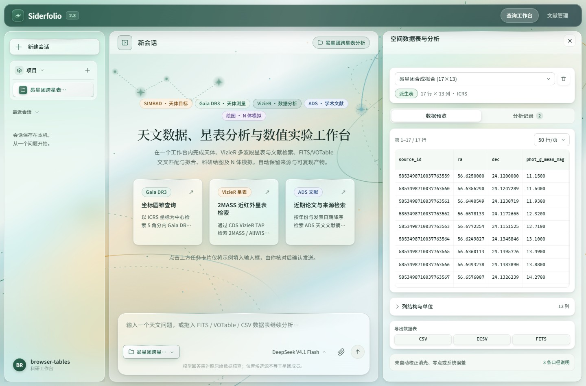
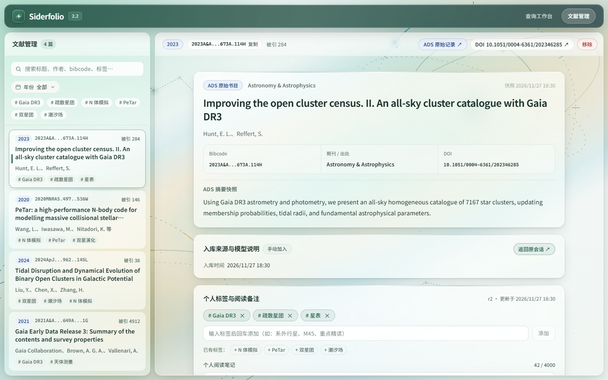
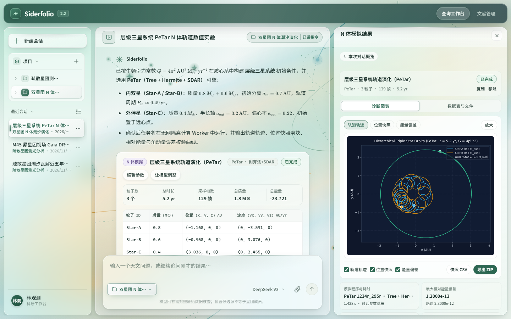
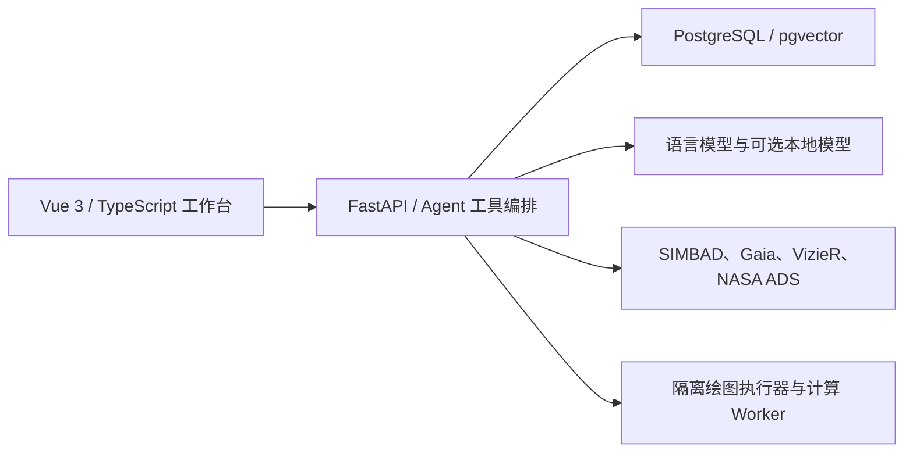

<div align="center">
  
  <h1>Siderfolio</h1>
  <p>面向天文学研究者和科研课题组的 AI 科研工作台</p>
  <p>
    <a href="https://www.siderfolio.com/login">在线使用</a> ·
    <a href="#快速开始">本地运行</a> ·
    <a href="https://github.com/lct808846/siderfolio/releases">版本记录</a>
  </p>
</div>

Siderfolio 把天文数据检索、文献管理、星表分析、科研绘图和 N 体模拟放在同一个工作台。研究者可以在对话中提出问题，再在结果栏核对数据来源、查询条件、单位和计算参数。会话、资料和运行结果可以按课题归档，便于回看和复现。

## 科研工作台一览

下列桌面画面展示不同科研任务。图中包含用于演示的样本与实验数据。

### 查询与科研绘图

从查询工作台发起天体、星表或文献检索。在结果栏预览图表，也可下载 PNG、PDF、绘图脚本与对应数据。


### 星表数据分析

预览观测列、源编号和单位。筛选、坐标变换、交叉匹配和拟合生成的派生数据可以留在项目中继续分析。



### 文献管理

按标题、作者或标签查找已保存的论文，查看 ADS 原始记录、DOI 与摘要，并添加阅读笔记。



### N 体数值实验

检查初始条件后执行模拟，在同一界面查看轨道、位置快照和能量误差，并导出实验数据。



## 核心能力

| 科研任务 | 工作台支持 |
| --- | --- |
| 天体与星表检索 | 查询 SIMBAD 天体标识和坐标、Gaia DR3 视场样本以及 VizieR 多波段星表，保留数据源、坐标系、历元和查询条件。 |
| 星表整理与数值分析 | 导入 FITS 表、VOTable、ECSV、CSV 和 TSV，或保存 Gaia DR3 与 VizieR 查询结果。支持描述统计、筛选、派生列、坐标变换、球面交叉匹配和曲线拟合。 |
| 文献调研与项目问答 | 通过 NASA ADS 检索文献并保存到个人文献库。项目可导入 PDF、Markdown 资料，预览检索到的原文证据，确认后生成带引用的回答。 |
| 科研绘图 | 从查询结果或项目数据表生成可审阅的 Python／Matplotlib 或 Gnuplot 脚本，经确认后在隔离环境执行，输出图形及复现所需的数据和脚本。 |
| N 体模拟 | 选择 REBOUND 或 PeTar 运行小规模点质量系统实验，查看轨道和能量诊断，并保留初始条件、程序版本和数值结果。 |
| 项目与复现 | 按课题组织会话、知识库和结果快照，支持按原条件重跑单项查询、比较快照和备份恢复。分析记录与项目均可导出为 ZIP。 |

Agent 通过服务端工具调用查询数据库和运行分析，模型负责理解问题、组织步骤与解读结果。工作台还支持常见文档与图片附件、科研技能、可选 MCP 工具、跨会话记忆和运行追踪。会话与科研数据按账号隔离，绘图和模拟在没有外网访问的受限容器中执行。

## 快速开始

直接访问[线上工作台](https://www.siderfolio.com/login)。在 Windows 上开发时，先打开使用 WSL2 Linux 引擎的 Docker Desktop，再在仓库根目录启动开发环境。

```powershell
.\scripts\dev.ps1 -Action Start
```

打开[本地开发预览](http://127.0.0.1:5173)。全新开发环境可用 `.\scripts\dev.ps1 -Action Account` 创建测试账号。使用 `-Action Update` 更新开发服务，使用 `-Action Status` 查看状态。

源码开发使用 Python 3.12+、Node.js 24.15+ 和带 `pgvector`、`pg_trgm` 的 PostgreSQL。模型、ADS 和邮件凭据保存在服务端，按需配置本地模型、语义检索、绘图和计算服务。[开发与发布手册](docs/DEVELOPMENT_AND_RELEASE.md) · [服务端配置示例](.env.example) · [Windows 开发配置示例](.env.dev.example)

## 架构与部署



Python 后端以 OpenAPI 定义接口，并生成前端 TypeScript 类型。生产环境使用 Docker Compose 与 Caddy 提供 HTTPS。GitHub Actions 运行测试、构建镜像并执行版本发布。主要实现位于 [后端源码](src/astroagent/)、[前端工程](frontend/) 与[容器配置](containers/)。

- [生产部署](containers/gcp/README.md)介绍 HTTPS、邮件、隔离运行和备份恢复。
- [测试文档](docs/TESTING.md)介绍离线回归、独立 PostgreSQL 测试和数值验收。
- [开发与发布手册](docs/DEVELOPMENT_AND_RELEASE.md)介绍本地开发栈、容器更新和正式发布。
