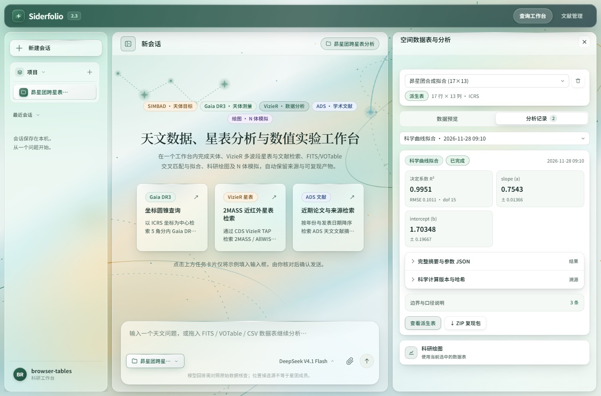
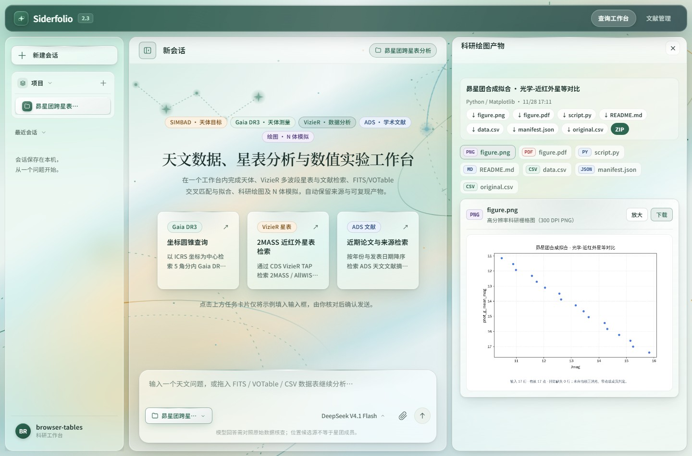
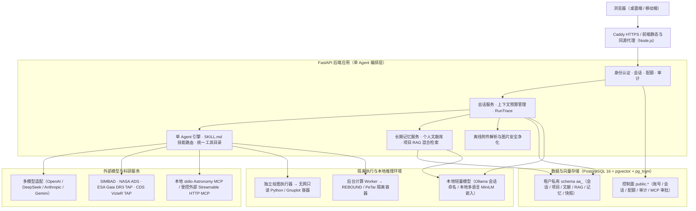

<div align="center">
  
  <h1>Siderfolio</h1>
  <p><strong>面向天文学研究者与科研课题组的 AI 辅助科研工作台</strong></p>
  <p>
    在线访问：<a href="https://www.siderfolio.com/login">https://www.siderfolio.com/login</a>
  </p>
  <p>
    天文数据库实时检索 · 星表交叉匹配与拟合 · 文献库与项目 RAG · 隔离科研绘图 · N 体模拟 · 科研技能与长期记忆
  </p>
</div>

---

## 项目简介

**Siderfolio** 是一套面向个人天文学研究者与小型科研课题组的全栈 AI 科研工作台，围绕「**真实数据源优先、物理单位明确、过程可核查、结果可复现、多账号严格隔离**」的原则构建。

研究者可以在同一工作台内以自然语言完成天体识别与视场检索、天文文献调研与归档、基于个人 PDF/Markdown 资料的带引文问答、可审阅脚本的隔离科研绘图，以及基于 **REBOUND** / **PeTar** 的小规模 N 体数值实验；所有外部查询与计算均保留完整条件、坐标系、单位、来源链接与运行追踪，并支持单轮数据打包与项目级归档备份。

---

## 实际运行截图

以下桌面截图来自 v2.3.0 隔离验收环境，使用合成星表演示实际计算结果。

### 星表导入与派生表预览

右侧结果栏展示交叉匹配后生成的派生表，可核对源编号和列并下载原始或派生数据。


### 拟合结果与复现记录

分析记录展示拟合系数、误差指标和适用范围，支持下载 ZIP 复现包。



### 隔离科研绘图

从已保存的数据表选择坐标列后，系统在隔离容器内生成图形，可导出 PNG 和 PDF。



[个人文献库示例](docs/assets/screenshots/literature-workspace.png) · [N 体模拟示例](docs/assets/screenshots/nbody-simulation.png)

---

## 核心能力

| 模块 | 能力说明 |
| --- | --- |
| **天文数据库查询** | 接入 **SIMBAD**（主站自动故障转移至哈佛镜像）、**NASA ADS**（精确检索式、分页与被引排序）与 **ESA Gaia DR3**（固定 `gaiadr3.gaia_source` TAP 查询、质量筛选与基础样本统计）；所有结果保留原始单位、历元、截断状态与来源链接，严禁模型凭记忆伪造测量值或论文。 |
| **科研项目、快照与固定流程** | 按课题组织会话、命名快照、单工具可复现重跑与双快照交集对比；内置「Gaia 视场候选源」「ADS 摘要证据表」固定科研流程，支持项目 ZIP 完整归档与校验恢复。 |
| **项目星表分析** | 支持导入 FITS 表、VOTable、ECSV、CSV 和 TSV，或将 Gaia DR3 与 VizieR 查询结果存入项目。提供坐标变换、球面交叉匹配、统计、筛选与拟合，派生结果保留数据来源并可用于隔离绘图。 |
| **个人文献库与项目 RAG 知识库** | 支持对话内显式授权幂等入库与手动整理个人 ADS 文献；项目知识库支持导入 PDF / Markdown 原文，基于 PostgreSQL 词法检索与 `pgvector` 本地嵌入混合检索，先预览原文证据段并经用户确认后再生成带页/行引文的回答。 |
| **隔离科研绘图与 N 体模拟** | 对话内生成可审阅的 **Python (Matplotlib)** / **Gnuplot** 绘图方案与 **REBOUND** / **PeTar** N 体初始条件草案；用户确认后在无网络、只读根文件系统、受限资源的独立容器中执行并归档高分辨率图表与轨道数据。 |
| **多模态附件分析** | 支持上传 PDF、DOCX、TXT/Markdown、CSV/TSV、JSON 及 PNG/JPG/WebP/GIF 图片附件，后端离线解析文本并对图片执行校验、去元数据重编码与分辨率收敛后传入多模态模型。 |
| **科研技能、MCP 与长期记忆** | 内置 `SKILL.md` 科研技能并按统一服务端工具目录渐进披露；支持本地 `stdio` Astronomy MCP 及默认关闭的受控外部 Streamable HTTP MCP（管理员逐项审批只读工具并锁定摘要，用户逐轮确认外发字段）；支持跨会话长期记忆、>24 轮长对话摘要压缩与脱敏运行追踪（RunTrace）。 |
| **多账号安全与运维管理** | 邮箱注册激活、Argon2id 口令哈希、CSRF 与同源防护、可选 TOTP 双因素认证、多设备登录管理与异地提醒、按账号用量配额与后台审计日志、站内用户反馈与域名邮件通知。 |

---

## 系统架构

Siderfolio 采用**前后端分离 + 单 Agent 服务端编排 + PostgreSQL 双层多租户隔离 + 无网隔离计算沙箱**架构：



### 核心架构边界

- **严格多租户隔离**：系统控制面（账号、设备会话、配额、模型配置、审计与外部 MCP 注册表）与业务数据分离；每位注册用户的会话、项目、文献、知识库、绘图记录、计算任务与长期记忆均存储在独立的 PostgreSQL 私有 schema（`aa_<32-hex>`）中。
- **不可信数据与执行隔离**：工具返回、文献原文、附件内容与长期记忆一律按不可信参考数据处理，无法扩大账号/项目权限或绕过用户确认；任何科研绘图脚本、N 体数值模拟与外部 MCP 外发查询均须经用户显式确认后在受限边界内执行。
- **单一契约源**：后端 FastAPI OpenAPI 规范自动生成前端 TypeScript 类型定义，保证前后端接口与数据结构严格一致。

---

## 技术栈

| 层级 | 技术与组件 |
| --- | --- |
| **前端界面** | Vue 3、TypeScript、Vite 7、Pinia、Vue Router、KaTeX、marked + DOMPurify、`popover="manual"` 顶层毛玻璃交互体系 |
| **后端服务** | Python 3.12+、FastAPI、Uvicorn、Pydantic v2、psycopg 3、LangChain Core / OpenAI / Anthropic / Gemini 多协议模型适配 |
| **数据库与检索** | PostgreSQL 16、`pgvector`（语义向量检索）、`pg_trgm`（中英文词法检索）、`sentence-transformers`（本地多语言嵌入） |
| **天文与科学计算** | `astroquery`、`astropy`、`defusedxml`（严格 VOTable 解析）、NumPy、Matplotlib、Gnuplot、REBOUND、PeTar、Pillow、`pypdf` |
| **工具协议与扩展** | `mcp`（Model Context Protocol，支持本地 `stdio` 与受控外部 Streamable HTTP）、内置 `SKILL.md` 技能规范 |
| **认证与安全** | Argon2id（`argon2-cffi`）、Fernet 对称加密（`cryptography`）、TOTP MFA、CSRF 双重防护、出站 DNS/IP 校验 |
| **容器与部署** | Docker Compose、Docker Buildx Bake、Caddy（自动 HTTPS 与边缘头透传）、Rootless 隔离绘图执行器、GitHub Actions CI/CD + GHCR |
| **测试与质量保障** | Pytest、Ruff、Vitest、ESLint、`vue-tsc`、Playwright（Chromium / Edge 端到端）、REBOUND/PeTar 数值回归校验 |

---

## 目录结构

```text
siderfolio/
├── src/astroagent/              # FastAPI 后端源码
│   ├── api/                     # HTTP 路由（会话、项目、文献、知识库、技能、记忆、MCP、绘图、计算、管理等）
│   ├── skills_data/             # 内置 SKILL.md 科研技能定义
│   ├── agent.py                 # 单 Agent 工具调用与执行编排
│   ├── tool_catalog.py          # 统一服务端工具目录与清单摘要
│   ├── skills.py / skill_store.py      # 技能解析、渐进披露与偏好存储
│   ├── memory_service.py / memory_*.py # 长期记忆提取、摘要合成、长对话压缩与检索
│   ├── external_mcp_client.py   # 受控外部 Streamable HTTP MCP 客户端与出站防线
│   ├── simbad.py / ads.py / gaia.py    # 天文数据库适配器与统计分析
│   ├── literature*.py / knowledge*.py / rag*.py # 个人文献库与项目 RAG 知识库
│   ├── plotting*.py / compute*.py      # 隔离绘图与 REBOUND/PeTar 计算队列
│   ├── auth*.py / identity.py / usage.py # 多账号认证、租户隔离与配额审计
│   └── main.py                  # 应用装配与中间件入口
├── frontend/                    # Vue 3 + TypeScript 前端工程
│   ├── src/views/               # 工作台、文献管理、项目总览、知识库、流程、设置、管理后台等页面
│   ├── src/components/          # 对话卡片、结果面板、UiSelect、StatusNotice、技能与记忆组件
│   ├── src/stores/ & src/api/   # Pinia 状态管理与类型化请求封装
│   └── tests/                   # Vitest 单元测试与 Playwright 端到端浏览器测试
├── containers/                  # 容器构建与部署编排
│   ├── application/             # 后端与计算 Worker Dockerfile 及锁定依赖
│   ├── frontend/                # 前端生产镜像与同源代理入口
│   ├── plotting/                # 无网只读 Python / Gnuplot 绘图沙箱镜像
│   ├── gcp/                     # Ubuntu 服务器 Docker Compose + Caddy HTTPS 生产部署套件
│   └── release/                 # Docker Buildx Bake 多目标发布构建定义
├── scripts/                     # 本地开发、类型生成、CI 验收与发布脚本
├── tests/                       # Python 离线单测与隔离 PostgreSQL 集成测试
├── docs/                        # 架构设计、UI 规范、开发发布手册与验收记录
└── .github/workflows/           # 自动化测试（test.yml）与正式发布（release.yml）流水线
```

---

## 快速开始

### 环境要求

- **Docker 方式（推荐）**：Docker Desktop（Windows 需开启 WSL2 Linux 容器引擎）或 Linux Docker Engine + Docker Compose v2
- **源码方式**：Python `3.12+`、Node.js `24.15+`、PostgreSQL `16`（启用 `pgvector` 与 `pg_trgm` 扩展）

### 1. 本机容器开发环境（推荐）

在仓库根目录启动完整本地开发栈（包含 PostgreSQL/pgvector、FastAPI 热重载、Vite HMR、本地小模型与隔离执行环境）：

```powershell
# 可选：按需复制 .env.dev.example 为 .env.dev 配置本地模型或计算服务
.\scripts\dev.ps1 -Action Start
```

启动完成后打开浏览器访问默认预览入口：`http://127.0.0.1:5173`。常用维护命令：

```powershell
.\scripts\dev.ps1 -Action Update                 # 增量更新并核对服务健康
.\scripts\dev.ps1 -Action Status                 # 查看容器运行状态
.\scripts\dev.ps1 -Action Logs -Service backend  # 查看指定服务日志
.\scripts\dev.ps1 -Action Stop                   # 停止开发环境（保留数据卷）
```

### 2. 本地源码手动启动

```powershell
# 后端
python -m pip install -e ".[dev,mcp,rag]"
python -m uvicorn astroagent.main:app --host 127.0.0.1 --port 8000 --workers 1

# 前端（新终端）
cd frontend
npm ci
npm run dev
```

所有外部模型 API 密钥、NASA ADS Token、数据库凭据、SMTP 与外部 MCP 凭据均仅保存在服务端私有配置或环境变量中（详见 `.env.example` 与 `containers/gcp/.env.example`），严禁写入前端 `VITE_*` 变量或提交到仓库。

### 3. 服务器生产部署

面向 Ubuntu Linux 服务器的完整 Docker Compose + Caddy HTTPS 部署、域名邮件配置、隔离绘图/计算启用及备份恢复流程见 [生产部署与启动说明](containers/gcp/README.md)；单次授权的 CI/CD 与 GHCR 正式发布流程见 [开发与发布手册](docs/DEVELOPMENT_AND_RELEASE.md)。

---

## 常用检查与测试

```powershell
# 后端静态检查与离线单元测试（禁止外网 HTTP，无需真实密钥）
python -m ruff check src tests scripts
python -m ruff format --check src tests scripts
python -m pytest -m "not live and not postgres" -q

# 同步并校验 OpenAPI 与前端 TypeScript 类型
python scripts/generate_frontend_types.py --check

# 前端类型检查、Lint、单元测试、生产构建与浏览器端到端测试
cd frontend
npm run typecheck
npm run lint
npm test
npm run build
npm run test:browser
```

隔离 PostgreSQL 集成测试、数值计算回归验收与安全审计说明详见 [测试文档](docs/TESTING.md)。

---

## 相关文档

- [开发与发布手册](docs/DEVELOPMENT_AND_RELEASE.md) — 本地开发栈、容器更新与自动化正式发布流程
- [生产部署说明](containers/gcp/README.md) — Ubuntu 服务器、Caddy HTTPS、RAG、隔离绘图与备份恢复
- [UI 设计规范](docs/UI_DESIGN_SPEC.md) — 主题变量、毛玻璃组件、交互一致性与视觉审查清单
- [域名邮件与用户反馈](docs/SIDERFOLIO_MAIL_AND_FEEDBACK.md) — SMTP 发信、配额监控与站内反馈机制
- [测试文档](docs/TESTING.md) — 离线测试、PostgreSQL 集成与科学数值回归口径
