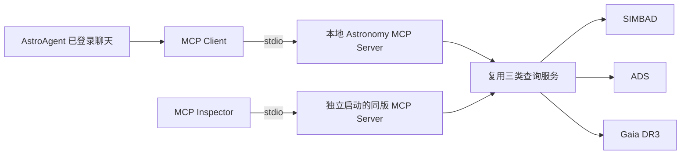

# AstroAgent V1.8 开发文档｜Astronomy MCP Server

**日期** 2026-11-21　**目标版本** `1.8.0`　**状态** 已实现。 [实际交付](development/v1.8.0/RELEASE.md) · [增量验收](test-records/v1.8.0/changed-parts/20261122T082958Z/README.md)

**基线** `v1.7.0`（`b1c0cc4`）。现有 AstroAgent 支持 SIMBAD 天体查询、ADS 文献检索和 Gaia DR3 查询，并已提供项目计算任务与 REBOUND、PeTar 执行流程。V1.8 将三项查询能力封装为可独立运行的 MCP Server，让 AstroAgent 和其他支持 MCP 的客户端调用同一套工具。[V1.7.0 发布说明](development/v1.7.0/RELEASE.md)

## 1. 交付范围

| 交付物 | 完成时的行为 |
| --- | --- |
| 独立 Astronomy MCP Server | 客户端能够启动本地服务、发现固定工具清单，按公开参数调用 SIMBAD、ADS、Gaia 并读取结构化结果 |
| AstroAgent MCP Client | 部署者启用后，聊天中的三项查询通过 MCP 完成，网页继续展示现有结果卡片、来源、错误状态与导出数据 |
| 使用与验收说明 | 提供 Windows 和容器部署方式、ADS 凭据配置、可复制的调用例和故障指引，以 AstroAgent 和 MCP Inspector 分别验收 |

首版范围限定在公开天文服务的只读查询。项目、会话、RAG 文档、绘图、模拟任务查询与提交、文件读写，以及任意脚本均在 MCP 工具清单之外。V1.7 计算任务继续通过站内项目工作区操作。MCP 服务仅向能在本机启动该进程的受信客户端开放，远程访问和第三方 MCP Server 接入单独立项。

## 2. 架构与协议



- **服务复用。** MCP 适配器直接调用 `SimbadService.query`、`AdsService.search`、`GaiaService.query`，复用 `schemas.py` 的输入与输出模型。服务可在没有 PostgreSQL、模型密钥或 FastAPI 进程的环境启动。查询端点、参数校验、结果解析和科研统计仍由现有 Python 服务维护。
- **协议与部署方式。** 使用官方 Python MCP SDK，首期以 `2026-07-28` 规范的 `stdio` 为目标。客户端通过 `server/discover` 核认协议和能力，再用 `tools/list` 获取清单、`tools/call` 调用工具。由 SDK 处理协议元数据、消息关联与生命周期。在实施阶段锁定 SDK 及验收客户端版本，记录实际协商版本。较早客户端只在实际验证后列入支持矩阵。首期配置无 MCP HTTP 监听端口。[MCP 版本与协商](https://modelcontextprotocol.io/docs/2026-07-28/learn/versioning) · [stdio 规范](https://modelcontextprotocol.io/specification/2026-07-28/basic/transports/stdio) · [Python SDK](https://py.sdk.modelcontextprotocol.io/)
- **宿主接入。** AstroAgent 在后端内用固定客户端适配器。启动时核对三个工具的名称和契约，运行时将响应解析回原有结果模型。模型继续使用现有工具名与批次校验、调用上限、上下文裁剪规则。MCP 工具描述和响应不能替换模型系统指令。此版接入无状态聊天与会话聊天共用的 Agent 工厂，项目重跑与固定科研流程继续使用原服务。

## 3. 首批工具与科研语义

| 工具名 | 输入约束 | 输出和限制 |
| --- | --- | --- |
| `query_simbad` | `object_name` 为 1–200 字符的天体名称或标识符 | 主标识符、ICRS 赤经赤纬（度）、天体类型、光谱型、坐标文献编号与来源。沿用现有无通配查询及受限镜像策略 |
| `search_ads` | `query` 采用 ADS 检索式，URL 编码后至多 1,000 字符。`rows` 为 1–10，`start` 为 0–90，`start + rows` 至多 100。沿用相关度、时间、引用次数排序 | 返回书目、摘要、bibcode、DOI、检索条件和分页状态。每次请求仅取一页，固定天文学库，摘要和书目按原始来源标注 |
| `query_gaia` | `mode=source_id` 使用正的 64 位有符号整数的字符串表示。`mode=cone` 使用 ICRS 度制坐标，`radius_arcmin` 大于 0 且至多 30，`limit` 为 1–500，支持已有质量、视差、自行和星等筛选 | 只查询 Gaia DR3 的 `gaiadr3.gaia_source`。保留实际条件、固定模板生成的 ADQL、单位、参考历元、截断、归档溢出与样本统计。`source_id` 端到端保持字符串 |

三个工具以现有 Pydantic 参数定义为准，声明输入和输出 JSON Schema。字段说明应包含单位、默认值和排他参数，服务器仍执行包括数值有限性、分页和 Gaia 查询模式在内的跨字段校验。用天体名称查询 Gaia 的场景由客户端先调用 SIMBAD，取得有效坐标后再请求 Gaia。圆锥结果称为位置候选源，统计仅代表交付样本。缺失测量保留 `null`，可选距离估计沿用现有适用条件、方法和精度说明。[V0.3 Gaia 查询设计](PROJECT_PLAN_V0.3.md)

对外结果在 `structuredContent` 提供 `schema_version`（首版为 `1`）、`tool`、`result` 和 `error`。`result` 为该工具的原有结构化结果，此时外层 `error` 为 `null`，原有业务错误通过 `result.error` 表达。适配器层能给出错误结果时，`result` 为 `null`，外层 `error` 提供脱敏的 `code`、`message` 和 `retryable`。另提供同内容的兼容文本块，供仅读取文本的客户端使用。现有 `source`、`retrieved_at`、状态、实际参数、缺失项、分页和截断字段完整保留。AstroAgent 校验并使用结构化结果，再按旧规则给模型裁剪上下文，API 和归档使用完整的有界结果。失败记录中的来源链接标记为查询目标。[MCP 工具与结构化输出规范](https://modelcontextprotocol.io/specification/2026-07-28/server/tools)

## 4. 失败处理与访问边界

| 情况 | MCP 与 AstroAgent 的表现 |
| --- | --- |
| 有数据、无匹配、结果被截断 | 保留原有 `success`、`not_found` 或截断标记，`isError` 为 `false` 或省略。空结果与超时分别显示 |
| 工具参数无效、ADS 未配置、上游超时或限流 | 工具执行错误返回 `isError: true` 与稳定错误码。查询服务返回的结构化失败结果一并保留。其他工具已有的成功数据仍可查看 |
| 不支持的工具名或不合法的 RPC 结构 | 返回相应 JSON-RPC 错误，请求在发起上游访问前结束 |
| 子进程退出、返回不符合契约、响应超限 | 显示 MCP 层错误。终止或回收异常连接，后续新请求可以重新建立连接。状态不明的同次查询不自动重发，也不再走直连路径。先前成功结果附原响应的降级提示 |

- 外部客户端以自己的本机权限启动已安装的服务。AstroAgent 仅启动随应用部署的固定模块，禁止从对话、网页或请求中接受启动命令、参数表或服务地址。调用先经过现有登录、请求检查和并发限制。MCP 子进程仅获得查询必需配置，ADS token 通过独立进程环境安全注入，排除模型、数据库、邮件、会话凭据。`stdio` 本身不提供额外的文件或进程沙箱，部署权限按实际运行用户和挂载范围核对。
- 只向查询服务提交规范化后的天体名、检索式或 Gaia 条件。整个对话、会话标识、上传内容和私有文档不得随同发送。ADS 摘要与外部返回文本作为资料处理，沿用文本渲染和现有模型信任规则。查询目标由服务代码固定，工具拒绝调用方自定义的 URL、数据表、SQL 或 ADQL。
- 继承各服务的连接、读取及结果限制。为 MCP 另设启动与单调用总时限、消息大小、进程并发和等待上限。AstroAgent 连接池起始上限与现有两轮并发一致，每条连接同一时刻执行一个调用。取消后丢弃迟到响应，正在阻塞的调用在确认退出后才释放执行槽，必要时回收对应子进程。直连和 MCP 共享原有聊天调用预算。独立客户端进程使用自己的限流，多个进程共用同一 ADS token 时按同一上游配额计算。
- 日志记录请求关联 ID、工具名、协议版本、耗时、结果状态、返回量与错误码。日志走标准错误，标准输出只用于 MCP 消息。日志排除查询全文、摘要、用户标识、凭据及原始上游错误。V1.9 可用这些字段衔接评估与追踪。

## 5. 配置、调用与操作说明

计划提供 `python -m astroagent.mcp_server` 作为独立入口，以及服务端 `ASTROAGENT_ASTRONOMY_TOOL_TRANSPORT=direct|mcp` 作为 AstroAgent 切换项。升级默认沿用 `direct`。启用 `mcp` 后，配置错误和连接失败应明确显示，不在一次请求中自行切换。独立启动需在受信的本机环境配置 ADS token。缺少 token 时 SIMBAD 和 Gaia 可正常查询，ADS 返回配置缺失。凭据从进程环境或部署私有配置显式注入，启动命令、客户端共享样例和网页不含密钥。

开发交付包括可选 `mcp` Python 依赖、后端镜像的依赖锁定，以及 Windows 本地启动与 Linux 容器说明。容器方式由后端容器内的固定进程启动，无需开放端口或调整现有数据卷。独立客户端也可在自己的 Python 3.12 环境启动同一个模块。只有后端配置启用 MCP 时才初始化客户端。操作手册须说明如何确认正在使用 MCP、如何切回直连以及两个客户端各自的配置方式。

以下为三次独立 `tools/call` 的参数示例。Gaia 示例使用手填坐标，联动验收时以本次 SIMBAD 返回的坐标为准。[MCP Inspector 用法](https://modelcontextprotocol.io/docs/2026-07-28/tools/inspector)

```json
[
  {"name":"query_simbad","arguments":{"object_name":"M45"}},
  {"name":"search_ads","arguments":{"query":"abs:\"open clusters\"","rows":3,"start":0}},
  {"name":"query_gaia","arguments":{"mode":"cone","ra_deg":56.75,"dec_deg":24.12,"radius_arcmin":5,"limit":20}}
]
```

## 6. 实施与验收

| 阶段 | 交付与完成条件 |
| --- | --- |
| M0 | 锁定 SDK、协议与外部客户端版本，固定三个输入输出契约、异常映射和资源限值 |
| M1 | 实现独立 MCP Server，用替身覆盖工具发现、结构化响应、无匹配、跨字段限制及错误 |
| M2 | 在聊天主链路接入固定 MCP Client，完成进程回收、错误展示与原有结果兼容 |
| M3 | 补齐 Windows、容器与 Inspector 手册，完成版本依赖与配置交付 |
| M4 | 按用户安排验收，两端保留同一版本的证据和外部服务限制 |

- [ ] AstroAgent 开启 MCP 后，三项工具都从真实协议链路取得结果。MCP Inspector 从独立本机进程发现并调用同样三个工具，记录服务版本、协商版本、输入结构和输出校验。
- [ ] 对固定合成响应比较直连与 MCP 的科学字段和状态，核对 Gaia 长整数编号、缺失值、统计样本、截断与溢出，核对 ADS 页边界和文献来源。网页结果卡片、来源与既有导出可读，V1.7 计算任务用代表样例回归。
- [ ] 核对空结果、参数越界、上游超时、限流、无 ADS token、子进程意外退出、不兼容协议、取消与并发饱和。部分成功仍有原始证据，进程回收后新请求可继续，结果超限不会被静默变成空结果或缩短数据。
- [ ] 验证无站内匿名访问、MCP 清单只有三项工具、启动参数仅来自服务端、标准输出无日志、私有凭据未进入结果与记录。默认直连和切换流程均可用，启用 MCP 无须对外发布端口。
- [ ] 在用户安排的真实服务验收中分别取得 SIMBAD、ADS、Gaia 的有效结果。ADS 使用获授权的 token，Gaia 校验 TAP 查询结果与数据字段。分别记录连接、工具调用及真实数据成功的证据，上游失败或跳过项按实际状态记录。

开发期间遵照仓库约定。功能验收记录放在 `docs/test-records/v1.8.0/<类型>/<UTC时间>/`，包含提交、依赖、客户端与协议版本、样例、成功、失败和跳过项。部署后的启动健康检查与功能验收分别记录。

## 7. 后续版本

V1.9 建立固定评估集与模型、工具和任务追踪，比较证据质量、失败原因、延迟、资源和成本。V2.0 推进生产部署与多用户运维，Multi-Agent 在 V2.x 按独立证据评估。远程 MCP、站内数据读取或模拟任务控制按实际需求另立契约，覆盖身份、数据范围和操作确认。[版本路线图](ROADMAP.md)
