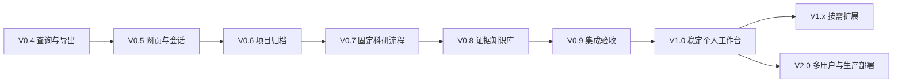

# AstroAgent 版本路线图

**更新日期：** 2026-11-16

当前候选源码：V1.6.0 RC1（Python `1.6.0rc1`）。邮箱身份、用户隔离、MFA、模型服务商、个人资料与界面改动已完成对应范围的自动验收和本机部署；见[候选版说明](development/v1.6.0/RELEASE_RC1.md)及[最新增量记录](test-records/v1.6.0/changed-parts/20261116T071217Z/README.md)。候选发布以 GitHub 上目标提交的 main/tag 检查和 Release 状态为准；不将本机验收扩展为公网安全或所有服务商生成可用。以下 V1.5 及更早开发状态作为历史保留。

当前开发版本：V1.5 `1.5.0.dev0`，本地千问4B助手、异步命名和显式轻量文本操作源码已接入；Ollama及模型已在D盘准备。见[实施记录](development/v1.5.0/IMPLEMENTATION.md)，本轮未运行推理、测试、构建或验收，未发布。V1.3 改动范围的本机测试见[独立验收记录](test-records/v1.3.0/acceptance/20261109T003436Z/README.md)，不作为 V1.5 通过证据；下方旧版状态保留为历史。

新增的整体容器化范围已提供部署配置、内部服务安全适配、专用VM绘图执行器及维护脚本源码，见[容器实施记录](development/v1.5.0/CONTAINER_IMPLEMENTATION.md)；环境准备、构建、启动和验收均待明确安排。

**状态：** V0.5 与 V0.6 已发布；V0.7 验收见[本版记录](test-records/v0.7.0/README.md)；V0.8 知识库与当次验收见 [测试记录](test-records/v0.8.0/README.md)。V0.9 已执行本地与部分真实服务验收，Gaia 查询超时未通过，按用户决定留待后续版本；详见 [V0.9记录](test-records/v0.9.0/README.md)。V1.0 PostgreSQL/RAG/配置/格式5及迁移维护源码及后续验收见 [独立记录](test-records/v1.0.0/README.md)，Gaia例外及历史失败保留。当前开发目标V1.1为观测日志界面重构，本轮源码已写入、未测试或发布；远程发布状态以 GitHub Releases 为准。
**原则：** 先让现有查询能力可用、结果可核对，再逐步引入项目、流程与知识库；版本按验收完成情况推进，不承诺未经评估的日历日期。

## 1. 既有基础与当前工作

| 版本 | 能力范围 | 本文使用的状态依据 |
| --- | --- | --- |
| V0.1 | 自然语言、SIMBAD、FastAPI、基础错误处理 | [V0.1 文档](PROJECT_PLAN_V0.1.md) 与历史测试记录 |
| V0.2 | ADS 检索、书目/摘要、来源与失败降级 | [V0.2 文档](PROJECT_PLAN_V0.2.md) 与历史测试记录 |
| V0.3 | Gaia DR3、程序统计、有条件的近似距离、三工具衔接 | [V0.3 文档](PROJECT_PLAN_V0.3.md) 与历史测试记录 |
| V0.4 | 快照 JSON、CSV、三类 Gaia 图、ZIP、SHA-256 清单 | [V0.4 文档](PROJECT_PLAN_V0.4.md) 与[实际记录](test-records/v0.4.0/README.md) |
| V0.5 | 本机网页、连续对话、本地会话、预览和下载 | [V0.5开发契约](PROJECT_PLAN_V0.5.md)、[本轮记录](test-records/v0.5.0/README.md) 与[源码发布页](https://github.com/lct808846/astroagent/releases/tag/v0.5.0)，保留 SIMBAD 限制 |
| V0.6 | 项目、命名快照、单工具重跑、比较与归档恢复 | [实现契约](PROJECT_PLAN_V0.6.md)、[验收记录](test-records/v0.6.0/README.md)与[源码发布页](https://github.com/lct808846/astroagent/releases/tag/v0.6.0)，主站故障可转哈佛镜像，本次联网21/21通过 |

上表描述功能基线，不替代远程发布审计。V0.4 历史记录中的 SIMBAD 超时与未通过路径需要在新版本重新核对；带限制发布的历史授权只适用于当次版本。

原 V0.1 路线图将“科研工作流、知识库和用户界面”统一安排在 V1.0；本次把这些目标拆为下列可单独验收的阶段。V2.0 仍保留生产部署方向；单用户数据保护、输入验证与错误脱敏贯穿各版。按用户约定，开发阶段不主动运行测试，由用户在发布前安排验收。

## 2. 版本顺序与退出标准

| 版本 | 主要目标 | 最小交付 | 进入下一阶段前的证据 |
| --- | --- | --- | --- |
| **V0.5** | Web 界面与连续对话 | 独立 Vue 3 / TypeScript / Vite 前端、FastAPI、SQLite 会话、上下文引用、完整结果、图表预览与 ZIP 下载 | 旧 API 回归；会话重启恢复/幂等；前端构建与浏览器全流程；预览与下载一致；真实链路限制有记录 |
| **V0.6** | 项目与查询归档 | 项目下组织多个会话、命名数据集、保存查询条件、项目归档/恢复、显式重跑与版本比较 | 备份恢复可核对；新旧数据不覆盖；条件/来源/版本关系完整；迁移可回滚 |
| **V0.7** | 可追溯科研流程 | 固定步骤模板、显式参数、依赖检查、逐步结果与断点恢复 | 至少两条代表流程端到端验收；失败后恢复不重复执行成功步骤；每步来源与派生规则可核查 |
| **V0.8** | 个人知识库与证据检索 | 本地文本型 PDF / Markdown 导入、解析、索引、带页码/段落的检索与引用 | 基准集检索评估；引用可回到原文；无依据时拒答；删除后关联索引清理；隔离文档内指令 |
| **V0.9** | 集成与候选稳定版 | 网页/项目/流程/知识库打通、数据迁移、回归评估、安装与恢复演练 | 全流程固定评估集；数据库迁移及归档兼容；主要缺陷清零；已知限制与支持矩阵完整 |
| **V1.0** | 完整个人科研工作台 | 首次配置、PostgreSQL + pgvector、RAG 混合检索和带引用问答、旧数据迁移与备份恢复 | 从干净环境到文献导入/检索/引用/问答/恢复全链路通过；科学评估、兼容性与本地/CI 门槛通过 |
| **V1.1** | 观测日志界面重构 | 统一全局/项目导航、可切换面板、证据阅读层级和明确的设置状态 | 各工作区桌面/窄屏/错误状态、键盘和原业务回归；本轮源码已写入，待用户安排验收 |
| **V1.6** | 邮箱注册登录与后台管理 | 邮箱激活、强制登录、隐藏入口的管理员后台、用户数据隔离及旧数据归属迁移源码已接入 | [开发文档](PROJECT_PLAN_V1.6.md)与[实施记录](development/v1.6.0/IMPLEMENTATION.md)；真实邮箱、越权防护、数据迁移与业务回归待验收 |
| **V1.x** | 经验证的扩展 | 按需求增加单项数据源、交叉匹配或文献管理集成；每项另立契约 | 科学误差、范围、质量/性能边界及兼容性均有独立验收 |
| **V2.0** | 生产部署与多用户能力增强 | 在 V1.6 身份权限及用户隔离基础上，扩展服务端异步任务、配额、审计/Tracing、运行评估、备份与部署 | 跨用户数据/任务隔离、安全与压力测试、故障恢复和运维验收 |

V0.9 是集成阶段编号，正式发布的候选标签可使用 `v1.0.0-rc.N`，并与包元数据采用一致的预发布版本映射；具体策略在该阶段开发文档固定。不能为了达到 V1.0 版本号而把未实现能力列为已交付。

## 3. 各阶段范围

### V0.5：先完成个人使用闭环

主流程是“网页提问→追问→核查三类结果→预览→下载→恢复历史”。本地会话与有界上下文为必需能力；不引入 RAG、复杂编排或部署系统。详细接口、模型、资源限制和测试见 [V0.5 文档](PROJECT_PLAN_V0.5.md)。

前后端采用分离工程：Vue 3 + TypeScript + Vite，配合 Vue Router 和 Pinia；FastAPI 独立提供 API。业务库使用后端本机 SQLite，暂不增加数据库服务。两端分别安装、测试、构建，开发走 Vite 代理，构建后通过静态服务和 API 代理联调。

### V0.6：把对话结果变成可管理的项目记录

详细开发范围、接口和验收标准见 [V0.6 开发文档](PROJECT_PLAN_V0.6.md)，已实现项目、快照、重跑、比较及归档恢复；[实际验收](test-records/v0.6.0/README.md)保留原SIMBAD失败及镜像接入后通过记录，2026-10-29进入源码发布流程。

项目包含多个会话、查询快照与显式命名的数据集。保存用户条件、实际参数、来源时间、工具/包版本及文件哈希，支持项目导出和恢复。重跑必须由用户触发，明确会再次访问数据库/模型，产生独立快照；旧结果不被覆盖。

先支持条件、行数、状态与来源的变化比较。同一源的跨版本对应、自动合并与统计显著性判断另立规则，不能仅凭编号相同认定科学等价。项目归档应版本化，并验证路径、大小、成员和完整性；不导入凭证、不执行归档内代码。

### V0.7：可检查的固定科研流程

详细范围、执行恢复、归档兼容和验收要求见 [V0.7 开发文档](PROJECT_PLAN_V0.7.md)；两条固定模板、持久执行记录、检查点继续、Vue页面与格式2归档已写入代码。本地与联网结果见 [测试记录](test-records/v0.7.0/README.md)。

先实现显式步骤模板，不开放任意 Python 或自由生成代码执行。首批至少覆盖：

1. 名称/坐标输入→Gaia 视场候选源→程序统计→图表与导出；名称解析失败时中止依赖步骤。
2. 主题/年份输入→ADS 单页检索→按实际摘要整理证据表→保留书目和来源。

步骤参数、输入快照、输出、状态、耗时、版本和失败原因可查看；恢复时检查输入和版本是否变化，不默认复用失效结果。不把候选源流程命名为“成员分析”，不把摘要表称为“全文综述”。

可继续同步执行有界短流程；服务端后台队列和真正可取消的长任务在需求与机制完整后引入，不因出现流程模板就自动承诺异步能力。

### V0.8：加入有原文依据的个人知识库

详细范围、文件版本、可追溯检索、归档兼容及验收计划见 [V0.8 开发文档](PROJECT_PLAN_V0.8.md)。本地词法检索、摘录式回答、文档版本/原文定位与格式3归档代码已写入，不调用模型或远程嵌入；测试结果和边界见 [测试记录](test-records/v0.8.0/README.md)，发布状态以 GitHub Releases 为准。

首版仅处理用户选择的本地文本型 PDF 和 Markdown，不自动爬取论文全文、不绕过访问限制；扫描件 OCR、多模态表格/公式识别和协作文库另行评估。保存原文件身份与哈希，文献元数据缺失时明确留空；只对实际解析出的内容建立索引。

分开标明数据库测量、ADS 摘要、用户文档原文和模型解释。检索回答引用具体文档及页码/段落，说明无法解析或未覆盖的部分；模型记忆不能伪装为检索证据。文档删除和更新需清理/重建相关索引，保留处理状态及版本。

向量方案、嵌入模型与本地/远程推理方式在 V0.8 契约中通过样本评估选择，不提前绑定产品；如内容会发送外部服务，须在实际设计中明确数据流和用户选择。固定检索/拒答评估集从本阶段开始，不能把安装向量库当成知识库完成。

### V0.9 → V1.0：整合与稳定

V1.0 的稳定范围、Gaia 超时复验、兼容迁移与发布门槛见 [V1.0 开发文档](PROJECT_PLAN_V1.0.md)；当前源码实施与未验收边界见 [开发记录](development/v1.0.0/README.md)。

V1.0 须实现完整 RAG、配置本机向量数据库及完善首次使用体验，详见 [RAG 与数据库设计](RAG_ARCHITECTURE_V1.0.md)。用户明确选择证据并确认后才向回答模型发送片段；代码与页面以及后续验收均按 [V1.0记录](test-records/v1.0.0/README.md)区分，不能将历史阶段“未验收”或一次通过概括为全部当前状态。

V0.9 的项目来源关联、归档恢复、候选契约见 [开发文档](PROJECT_PLAN_V0.9.md)。旧开发期记录见 [开发记录](development/v0.9.0/README.md)，后续验收及Gaia限制见 [V0.9记录](test-records/v0.9.0/README.md)。V1.0稳定发布仍需后续完整验收。

统一项目、对话、流程和知识库的来源关系。冻结 V1.0 支持的数据库版本、查询范围、导出/归档格式、会话迁移与引用协议，提供从旧本地库升级、备份恢复和卸载数据的说明。

V1.0 服务于单用户科研辅助，默认本机部署；“稳定”指列明范围内经过验收，不代表全自动科研结论或生产级多租户能力。验收集中覆盖真实代表任务、错误恢复、科学限制和无证据回答；发布必须保留环境、提交、测试与已知限制。

### V1.x：逐项扩展，避免混成一次大改

V1.5 本地千问 4B 模型、会话自动命名及显式轻量文本任务源码已接入，详见 [开发文档](PROJECT_PLAN_V1.5.md)和[实施记录](development/v1.5.0/IMPLEMENTATION.md)；具体实现和验收状态以当前版本记录为准。整套项目容器化的源码及状态见[容器实施记录](development/v1.5.0/CONTAINER_IMPLEMENTATION.md)。

V1.6 邮箱激活注册、强制登录、通过网址访问的管理员后台和用户数据隔离源码已接入，详见 [V1.6 开发文档](PROJECT_PLAN_V1.6.md)与[实施记录](development/v1.6.0/IMPLEMENTATION.md)；尚未构建或验收。

V1.3 绘图范围见 [开发文档](PROJECT_PLAN_V1.3.md)：已实现模型调用 Python 与独立 Gnuplot，网页预览并选择保存；当次结果以[验收记录](test-records/v1.3.0/acceptance/20261109T003436Z/README.md)为准。V1.2 的状态及具体范围未在本轮核对。

V1.1以既定 UI 重构为重点，范围见 [观测日志界面重构](PROJECT_PLAN_V1.1.md)。本轮已统一七个页面的导航，六个多栏工作区在1200 CSS像素及以下切换面板；设置页区分未确认与已返回配置。当前为开发版本，源码与待验收项见 [开发记录](development/v1.1.0/README.md)，没有运行本轮检查。

可选方向包括新的星表/时域数据、明确边界的交叉匹配、BibTeX / Zotero 集成、报告输出、可复用工具接口（包括 MCP）。具体优先级根据实际任务确定，不作为 V1.0 的隐含承诺。

成员判定、消光/零点校正、贝叶斯距离、年龄/质量拟合、轨道或 N-body 分析属于科学方法扩展，必须另写假设、输入、验证集与误差评估。增加一个工具或图表不能代替这些方法的验证。

### V2.0：生产运行

在已有个人工作台基础上设计认证授权、逐用户数据与任务隔离、队列/取消/重试语义、配额、审计与可观测性、部署和灾难恢复。生产级 Evaluation 在基础评估之上扩展，持续评估不等到 V2.0 才开始。

V1.0 已将主业务库和向量存储规划为 PostgreSQL + pgvector；V2.0 需在此基础上设计多用户隔离、并发和生产运维，而不是把数据库选型本身视作多用户能力已完成。

仅修改监听地址、加登录页或部署到服务器不构成 V2.0；先完成访问边界与隔离契约，再开放多人使用。

## 4. 跨版本约束与依赖

- 接口兼容：旧客户端行为需回归；必须破坏兼容时先定义迁移/新接口，不静默改写原协议。
- 科学可信：保留真实查询、单位、时间、缺失、筛选、截断、失败与模型依赖假设；页面便利性不改变证据等级。
- 数据保护：凭证始终在服务端环境；本地会话/文献库不进入源码或测试归档；用户原始结果不因重跑而覆盖。
- 验收记录：每版、每类型、每次 UTC 时间独立保存；历史失败不删除，不拿旧报告改名充当本次结果。
- 开发与发布：开发阶段不主动运行测试；发布前由用户安排本地检查和对应远程 CI，满足约定门槛后再发布；依当次授权处理明确的外部限制，并在版本说明中如实记载。
- 范围控制：实施某版前确认上一阶段退出证据，编写该版契约；需要改变顺序或拆版时先更新路线图及对应验收范围。

V0.5 已发布并保留当时的 SIMBAD 缺口。V0.6 已发布；V0.7 已按独立契约实现并开展验收，具体结果和覆盖范围见本版记录。
