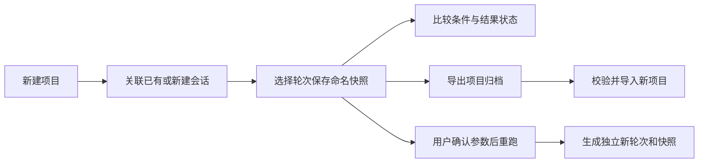

# AstroAgent 开发文档 V0.6：项目与查询归档

**文档日期：** 2026-10-29  
**状态：** 开发规划，尚未实现或验收  
**基线：** V0.5.0，本地标签 `v0.5.0`，发布提交 `c057010`  
**目标：** 将会话和查询结果组织为可保存、比较、迁移和恢复的科研项目。

本规划承接 [V0.5 开发文档](PROJECT_PLAN_V0.5.md) 和 [版本路线图](ROADMAP.md)。V0.5 已提供 Vue 前端、FastAPI、SQLite 会话与结果导出；V0.6 在此基础上扩展，不改变已发布版本的状态。实施前应重新核实基线、工作区及远程发布状态。

## 1. 范围与使用流程

用户创建项目，将已有会话加入项目，从某一轮的完整响应中保存命名快照，再按需比较两次快照或显式重新查询。项目可导出为归档，在另一份本地数据库中导入恢复。

本版交付项目管理、会话归属、不可变快照、参数核对后的显式重跑、两快照比较、项目归档与恢复，以及前端入口和验收记录。保留 V0.5 的单用户、本机、单 worker 约束及 Vue / FastAPI / SQLite 技术方案。

本版不新增全文下载、知识库、自动流程编排、成员判定、跨星表自动匹配、账号或多人共享。归档和比较结果不自动生成科研结论。

## 2. 现有能力与兼容

V0.5 使用 `/api/v1/conversations` 管理会话和轮次，完整 `ChatResponse` 存入 SQLite；原 `/api/v1/chat` 保持无状态；`/api/v1/exports` 导出单轮快照和图表。V0.5 的临时图表包存于内存，重启后消失。V0.6 项目归档与单轮 ZIP 是两个独立格式：项目包保存历史与命名快照，单轮 ZIP 继续用于数据和图表交付。

现有会话迁移后标为“未归档到项目”，不删除、不自动归类；用户可显式加入或移出项目。原有会话接口和已有聊天、导出响应保持兼容，旧会话 URL 仍可访问。项目列表显示会话引用，不改变原轮次顺序或结果内容。

V0.5 联网记录中 SIMBAD、名称→Gaia 和三工具完整成功路径存在超时缺口，详见 [V0.5 测试记录](test-records/v0.5.0/README.md)。这是历史结果，实施时须复测，既不假设当前仍超时，也不把旧版发布授权当作 V0.6 豁免。

## 3. 项目、会话和快照

| 实体 | 设计字段与规则 |
| --- | --- |
| 项目 | UUID、名称、可选说明、创建/更新时间、修订号；名称 1–100 字符，说明最多 2000 字符 |
| 会话关联 | 一个会话至多归属一个项目，也可无项目；移动为单次事务，不复制轮次 |
| 命名快照 | UUID、项目 ID、名称、原会话/轮次引用、完整响应 JSON、创建时间、内容 SHA-256、来源和软件版本信息 |
| 重跑关系 | 新旧快照 ID、发起时间、实际输入、执行条件、结果状态和失败信息；不覆盖旧快照 |

仅已有可交付 `ChatResponse` 的轮次可保存快照，`partial/error` 响应允许保存并完整保留错误；无响应的失败轮次仍在会话历史中。快照是保存时的完整副本，不能引用前端分页视图或模型裁剪视图。`source_id` 始终为字符串，未知与缺失保持原样。

快照内容不可修改；允许改名和删除。删除快照不删除原轮次；删除项目必须明确提示并要求确认，级联删除项目中的快照与关联关系，会话与轮次保留并变为未归档。运行中会话不能移动或删除所属项目；冲突返回可理解的错误，不静默等待或中断查询。

项目和会话使用乐观修订检查，两个标签页同时更改时拒绝过期写入。相同项目可有同名快照，但界面须显示时间和编号以便区分。

## 4. 重跑与比较

### 4.1 明确的重跑语义

V0.6 首版仅允许重跑某一条已保存的 SIMBAD、ADS 或 Gaia 工具查询，不把整段自然语言或历史上下文自动重放。用户从快照选中具体 `family + result_index`，页面先显示原始查询条件、数据源、查询时间及拟执行参数，用户确认后发起新查询；执行不依赖模型，也不重放历史工具调用。

重跑只使用当前固定数据源与现有参数验证和工具实现。对名称→Gaia 链路，原 Gaia 结果使用已记录的实际 ICRS 中心进行圆锥重跑；它不代表重新解析名称，页面必须显示该中心的历史来源与时间，并提供独立查询名称的入口。未保存完整参数、工具类型不支持或原数据不符合当前契约时禁用重跑并解释原因。重跑可能返回不同结果或失败，实际新查询参数、版本与 UTC 时间独立记录。

每次确认生成新的项目内会话轮次及独立快照，标注程序直接重跑，不假装由模型生成回答。复用既有 `ChatResponse` 语义构造完整结果和来源，确保单轮导出验证通过；不可把旧论文或旧测量混入新结果。网络失败也产生可追溯的失败记录。使用客户端 UUID 幂等键和项目修订号防止重复请求；同键不同请求返回 409，重试需新键。全局预算、超时、并发互斥和单工具边界在实现时明确并测试，不自动重试。

### 4.2 比较范围

支持同一项目中任意两个快照的并列比较；显示各自查询时间、工具、查询条件、状态、返回数量、截断/溢出、来源和软件版本。字段变化只做结构化差异：包括新增、删除、值变化、`null` 与未知；不把缺失当零或把未知总数当实际数量。

同源同模式同发布版的 Gaia 可在用户明确选择时按精确 `source_id` 字符串展示交集和各自独有编号；不将空间邻近或其他发布版编号认作同一源。ADS 可按 bibcode 精确列出交集；无 bibcode 的条目保留为不可匹配。SIMBAD 仅并列展示主标识和字段，不自动解决别名。对不同条件或截断样本明确标注“交付样本差异”，不解释为真实增减、显著性、成员变化或全星表变化。

比较只读取已保存快照，不调用模型或外部服务；保存时验证结构，比较时不改写原数据。程序确定输出排序，重复比较相同输入得到同样的结构化差异。

## 5. API 草案

下列路径和状态为待实现契约，沿用现有 `ErrorResponse`；OpenAPI 应说明请求、响应和错误。UUID 与未知字段严格校验，写请求遵守现有 Host / Origin 边界。

| 方法与路径 | 目的 |
| --- | --- |
| `POST /api/v1/projects` | 创建项目，201 |
| `GET /api/v1/projects`、`GET /api/v1/projects/{id}` | 列表与详情，200 |
| `PATCH /api/v1/projects/{id}`、`DELETE /api/v1/projects/{id}` | 按修订更新或删除项目，200 / 204 |
| `PUT /api/v1/projects/{id}/conversations/{conversation_id}` | 关联或移动会话；请求携带目标及原项目修订号 |
| `DELETE /api/v1/projects/{id}/conversations/{conversation_id}` | 移出会话，不删除历史，204 |
| `POST /api/v1/projects/{id}/snapshots` | 指定会话、轮次和名称保存完整快照，201 |
| `GET /api/v1/projects/{id}/snapshots`、`GET /api/v1/projects/{id}/snapshots/{snapshot_id}` | 列表与完整快照，200 |
| `PATCH /api/v1/projects/{id}/snapshots/{snapshot_id}`、`DELETE .../{snapshot_id}` | 改名或删除，200 / 204 |
| `POST /api/v1/projects/{id}/comparisons` | 提交两个快照 ID，返回有序差异，200 |
| `POST /api/v1/projects/{id}/snapshots/{snapshot_id}/reruns` | 提交目标工具索引、幂等键与修订号，创建重跑记录 |
| `GET /api/v1/projects/{id}/reruns/{rerun_id}` | 读取重跑状态及新结果引用，200 |
| `POST /api/v1/projects/{id}/archive` | 生成并下载当前一致性项目 ZIP，200 |
| `POST /api/v1/projects/import` | 上传项目归档并导入新项目，201 |

重复运行中的同键重跑返回 202 和原记录，完成后同键返回原结果；前端断开不表示已经取消，服务重启将遗留运行记录标记中断且不自动重放。不存在或归属不符为 404，修订冲突/运行中为 409，格式或字段无效为 422，大小超限为 413，资源忙/存储不可用为 503。导入校验失败不写入部分项目；错误不泄露路径或堆栈。

## 6. 项目归档与恢复

归档版本 `1` 使用 ZIP，成员只含 `manifest.json`、`project.json`、`conversations.json`、`snapshots.json`。文件路径由程序固定，UTF-8 严格 JSON，不包含密钥、环境文件、数据库文件、绝对路径、临时缓存或可执行脚本。`manifest.json` 保存格式版本、UTC 导出时间、应用版本、文件字节数与 SHA-256，不对自身计算哈希。归档包含项目元数据、所关联会话的完整轮次/状态/来源与命名快照及其关系；导出时使用一致的数据库读取快照，避免同时写入产生半套历史。

导入先在内存中校验 ZIP 成员、大小、唯一名称、哈希、严格 JSON、schema 和所有引用，再以单个数据库事务新建项目和数据；导入时生成新 UUID 并保存原 ID 作为来源元数据，建立明确映射，不覆盖现有项目。导入后默认保持独立副本；重复导入也创建新副本，不静默去重或合并。超出配额、损坏、引用断裂、未知版本、未知字段或不支持的响应结构均拒绝，给出原因并保留原文件。

导入数据标为 `imported_unverified`，哈希只能验证归档内部一致性，不能证明数据来自数据库或由本服务生成。历史时间、查询式与响应作为数据展示，不执行其中的 URL、文本或指令；导入和预览不触网、不调用模型。导入后显式重跑须重新验证参数并调用固定服务，旧数据保持原样。

限制作为实现目标：压缩包接收最多 32 MiB，解压总量最多 128 MiB、单成员最多 64 MiB，成员只能是上述四个固定文件，禁止重复名、目录穿越、绝对路径、符号链接及加密成员；流式累计实际接收和解压字节，不能只信 ZIP 元信息。达到资源上限时明确失败，不截断归档。导出包也遵守相同约束；先检查能否完整导出，不能交付半包。

归档不包含临时预览图；恢复后可由完整快照按原 V0.4 导出契约重新生成。原数据和图表计算方法可复核，但不同依赖、字体或导出时间可能导致 PNG / ZIP 字节变化。未随归档保存的额外用户文件不承诺恢复。

## 7. 存储、迁移与资源

沿用本地 SQLite 和短事务，新增项目、会话关联、快照和重跑记录；外键、唯一键和索引在迁移中显式定义。现有会话及 JSON 保持语义一致；schema 升级前使用 SQLite 一致性备份，迁移和版本变更在事务内执行，失败回滚，未知更高 schema 拒绝降级写入。用 V0.5 真实格式的脱敏数据库副本做迁移与恢复测试，不修改用户实际数据库。

设计上限：最多 20 项目，每项目最多 20 个会话关联和 100 个命名快照；继续执行 V0.5 每会话 40 轮、全库业务内容 256 MiB 等限制，快照副本与导入数据计入同一总配额，导入前预检且事务内再次检查。归档生成和导入各最多一个运行任务；不排队，忙时提示用户重试。比较最多读取两个快照，不新增模型调用。配额耗尽不能删除旧数据或覆盖历史。

业务数据与凭证仍分别管理；项目归档不代表数据库全量备份。多用户或多实例后的 PostgreSQL 迁移仍属于后续版本，不由本版引入。

## 8. 界面与代码位置

前端新增项目列表、项目详情、未归档会话入口、快照列表、对比页及导入/导出操作；所有危险操作显示影响范围。重跑展示原条件和来源并要求用户显式确认。部分成功、失败、截断、导入未认证和归档超限应在相应位置可见；项目筛选不改变数据本身。

计划在 `src/astroagent/` 新增项目仓储、快照比较、归档与 API 模块，扩展现有 SQLite 迁移和配置；在 `frontend/src/` 增加 Vue 页面、项目状态与 API 类型。沿用 V0.5 现有组件和 API 客户端，不重写科学计算、数据源访问或导出器。README、OpenAPI、测试说明和路线图随实现更新；文档阶段不修改版本号。

## 9. 实施阶段与验收

| 阶段 | 工作 | 验收点 |
| --- | --- | --- |
| M0 | 固定 V0.5 基线、迁移样本及 API 快照 | 记录旧状态和遗留失败，不覆盖已有工作 |
| M1 | 数据库迁移、项目/会话关系和快照 | 旧历史完整可读；约束、修订冲突及回滚通过 |
| M2 | 比较及显式单工具重跑 | 旧新独立、精确参数、幂等、失败状态和科学边界可核对 |
| M3 | 归档导出、验证和导入 | 全量历史与快照恢复；坏包拒绝且事务无部分写入 |
| M4 | 项目界面与前后端联调 | 创建、组织、保存、比较、重跑、导出、恢复可用 |
| M5 | 回归、联网及版本收尾 | 本地、浏览器、真实服务证据和已知限制完整 |

离线测试须覆盖旧会话迁移、失败回滚、项目关联与删除、完整快照不变、并发冲突与幂等、各工具成功/失败重跑、比较排序与缺失值、100 行数据、归档来回恢复和哈希。攻击边界覆盖损坏/重复成员、路径穿越、压缩膨胀、非有限 JSON、错误引用、未知版本、超限和数据库写失败。导入时拦截外网/模型调用；恶意文献文本在网页按数据展示。

真实 HTTP 验收使用临时数据库：建项目→关联历史→保存快照→重跑合成工具→比较→导出→重启→导入→逐项核对响应、轮次、来源、哈希和新 ID；测试异常中断与清理。前端运行类型检查、lint、单元与生产构建；用 Chromium / Edge 检查桌面和窄屏的完整流程、长文本、下载和键盘操作，并人工核对截图。

真实联网验收须显式启用，使用真实 Gaia、ADS 与 SIMBAD 查询分别验证记录和单工具重跑，并复验名称→Gaia 与三工具链路；缺凭证或服务失败如实记录，不用合成结果替代。SIMBAD 失败时独立保留 Gaia / ADS 成功与相关失败；远端超时不推断其根因。

验收证据保存为 `docs/test-records/v0.6.0/<类型>/<UTC时间>/`，每次新建目录，保留失败与环境、提交、命令和服务清理记录，不保存凭证或个人会话库。

- [ ] V0.5 会话、聊天、导出及科学规则回归通过。
- [ ] 项目管理、迁移、配额、事务和故障恢复通过。
- [ ] 重跑与比较的参数、来源、失败和幂等可核对。
- [ ] 归档完整恢复，损坏和恶意输入拒绝，无部分写入。
- [ ] 后端离线测试、Ruff、依赖检查、前端测试/构建及浏览器验收通过。
- [ ] 真实 HTTP 与联网验收有当次证据；外部失败和待补验路径单独记录。
- [ ] README、OpenAPI、版本说明同步；若发布，目标提交和标签 CI 均通过，发布限制按当次授权处理。

以上全部待实施。本文只规定开发与验收目标，不表示功能已实现或已发布。
